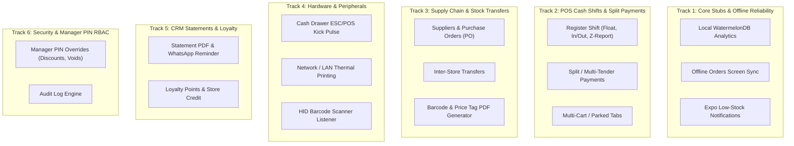

# OmniPOS Comprehensive Feature Implementation Plan

This plan outlines the end-to-end technical architecture and execution steps to implement missing core modules, transition online-only queries to offline-first WatermelonDB models, enhance POS cash register management, expand inventory supply chain workflows, and integrate essential retail hardware features.

---

## User Review Required

> [!IMPORTANT]
> **Database Schema Migration (WatermelonDB & Supabase)**:
> - WatermelonDB schema version will increase from `v5` to `v6` to add tables for `register_shifts`, `suppliers`, `purchase_orders`, `purchase_order_items`, `stock_transfers`, and `audit_logs`.
> - Split payments will update the `orders` table to store a JSON array of `payment_splits` alongside the legacy `payment_method` for backwards compatibility.

> [!WARNING]
> **Hardware Dependency Permissions**:
> - Cash drawer kick uses standard ESC/POS pulses sent through existing Bluetooth/Network printer connections.
> - Network/LAN printer support requires socket connection capabilities (`react-native-tcp-socket` or raw thermal ESC/POS network stream).

---

## Proposed Changes & Architectural Tracks

---

### Track 1: Core Stubs & Offline Data Reliability

#### [MODIFY] [wmSchema.ts](file:///c:/GAF%20Tech/OmniPOS/src/database/wmSchema.ts) & [migrations.ts](file:///c:/GAF%20Tech/OmniPOS/src/database/migrations.ts)
- Increment schema version to `6`.
- Add table `register_shifts` (columns: `store_id`, `cashier_user_id`, `opened_at`, `closed_at`, `opening_float`, `cash_sales`, `cash_in`, `cash_out`, `expected_cash`, `actual_cash`, `discrepancy`, `status`, `notes`, `dirty`).
- Add table `suppliers` (columns: `store_id`, `name`, `contact_person`, `phone`, `email`, `address`, `notes`, `dirty`).
- Add table `purchase_orders` (columns: `store_id`, `supplier_id`, `order_number`, `status`, `total_cost`, `expected_date`, `received_date`, `notes`, `dirty`).
- Add table `stock_transfers` (columns: `from_store_id`, `to_store_id`, `product_id`, `quantity`, `status`, `created_by`, `received_by`, `dirty`).
- Add table `audit_logs` (columns: `store_id`, `user_id`, `action`, `entity_type`, `entity_id`, `details`, `created_at`, `dirty`).

#### [MODIFY] [analytics/service.ts](file:///c:/GAF%20Tech/OmniPOS/src/features/analytics/service.ts) & [analytics.tsx](file:///c:/GAF%20Tech/OmniPOS/src/app/(tabs)/analytics.tsx)
- Replace direct Supabase HTTP queries with local WatermelonDB queries against `orders`, `order_items`, `returns`, and `product_batches`.
- Compute gross sales, net revenue, total orders, COGS (Cost of Goods Sold from product cost prices), gross profit margin, and top-selling items completely offline.
- Add periodic background sync trigger when online to refresh analytics data.

#### [MODIFY] [orders.tsx](file:///c:/GAF%20Tech/OmniPOS/src/app/(tabs)/orders.tsx)
- Query local WatermelonDB `database.get<Order>('orders')` with reactive subscriptions (`withObservables`) or `useFocusEffect` caching.
- Enable full text filtering across customer name, phone, order number, and payment status while offline.

#### [MODIFY] [notifications.ts](file:///c:/GAF%20Tech/OmniPOS/src/services/notifications.ts)
- Connect `notificationsService.notifyLowStock` with `expo-notifications`.
- Scan inventory reorder levels and schedule local push notifications when stock drops below minimum thresholds or batches expire within 30 days.

---

### Track 2: POS Cash Register Shift Management & Split Payments

#### [NEW] `src/database/models/RegisterShift.ts`
- Model for storing daily register shifts, opening balance, cash sales, paid-ins/paid-outs, and closing reconciliation.

#### [NEW] `src/features/shifts/` (service.ts, types.ts, hooks.ts)
- Shift lifecycle handlers: `openShift(openingFloat)`, `recordCashMovement('in' | 'out', amount, reason)`, `getShiftSummary()`, `closeShift(actualCash, notes)`.
- Generate and print X-Reports (mid-shift snapshot) and Z-Reports (end-of-day closure with full tax, category, and payment breakdown).

#### [NEW] `src/app/pos/shifts/index.tsx` & `src/app/pos/shifts/close.tsx`
- Dedicated Shift Dashboard UI displaying current drawer status, expected cash vs actual cash, cash in/out entry modal, and print Z-Report button.

#### [MODIFY] [order-info.tsx](file:///c:/GAF%20Tech/OmniPOS/src/app/pos/order-info.tsx) & [orderDraftStore.ts](file:///c:/GAF%20Tech/OmniPOS/src/store/orderDraftStore.ts)
- Support Split-Tender payment modal: enter amounts split across Cash, Card, Bank Transfer, Mobile Money, and Customer Credit.
- Validate that $\sum(\text{Split Amounts}) = \text{Total Due}$.
- Save payment splits array in order metadata for receipt printing and shift cash accounting.

---

### Track 3: Inventory Supply Chain (Suppliers, POs & Stock Transfers)

#### [NEW] `src/database/models/Supplier.ts` & `src/database/models/PurchaseOrder.ts`
- WatermelonDB models for vendor catalogs and inbound stock purchase orders.

#### [NEW] `src/features/suppliers/` & `src/features/purchaseOrders/`
- Supplier CRUD operations and Purchase Order status lifecycle (`draft` $\rightarrow$ `sent` $\rightarrow$ `partially_received` $\rightarrow$ `received`).
- On receiving a PO: automatically increment product stock, create batch records with expiry dates, log `StockMovement` entries, and track supplier invoices.

#### [NEW] `src/app/inventory/suppliers/` & `src/app/inventory/purchase-orders/`
- UI screens for managing vendors and creating purchase orders with item pickers.

#### [NEW] `src/components/organisms/BarcodeSheetModal.tsx`
- Generate printable multi-column barcode & price tag sticker sheets (PDF format via `expo-print`) for thermal label rolls and A4 sticker sheets.

---

### Track 4: Hardware Integrations (Cash Drawer, LAN Printing & HID Scanner)

#### [MODIFY] [service.ts (Printer)](file:///c:/GAF%20Tech/OmniPOS/src/features/printer/service.ts) & [buildReceiptJob.ts](file:///c:/GAF%20Tech/OmniPOS/src/features/printer/buildReceiptJob.ts)
- Add standard ESC/POS Cash Drawer Kick command: `[0x1B, 0x70, 0x00, 0x19, 0xFA]` (`ESC p 0 25 250`).
- Trigger drawer kick automatically upon completing cash payments or when manual "Open Drawer" button is tapped by authorized staff.
- Add Network/LAN socket printer connection option (IP + Port 9100) alongside existing Bluetooth ESC/POS.

#### [NEW] `src/hooks/useHardwareScanner.ts`
- Global key listener hook for Bluetooth / USB HID handheld 2D barcode guns that intercept rapid barcode keystrokes without needing the camera viewfinder open.

---

### Track 5: Customer CRM Enhancements & Loyalty

#### [MODIFY] [customers/[id].tsx](file:///c:/GAF%20Tech/OmniPOS/src/app/customers/[id].tsx)
- Add **Export Statement PDF**: Generates customer account statement with invoice history, payments made, and remaining debt using `expo-print` and `expo-sharing`.
- Add **WhatsApp Payment Reminder**: One-tap button that generates a personalized payment reminder message with store bank details and opens WhatsApp directly (`Linking.openURL`).

#### [NEW] `src/features/loyalty/loyaltyService.ts`
- Points calculation rule engine: Earn $X$ points per currency unit spent, redeem $Y$ points for $Z$ discount.
- Track customer loyalty balance and apply loyalty discounts in POS checkout.

---

### Track 6: RBAC & Manager PIN Overrides

#### [NEW] `src/features/auth/managerAuth.ts` & `src/components/molecules/ManagerPinModal.tsx`
- Reusable modal that prompts for a 4-6 digit Manager PIN before executing sensitive actions:
  - Applying cart discounts greater than store threshold (e.g. > 10%).
  - Processing order returns / cash refunds in [add-return.tsx](file:///c:/GAF%20Tech/OmniPOS/src/app/pos/add-return.tsx).
  - Voiding or deleting completed orders.
  - Viewing cost prices and gross margins on inventory screens.

#### [NEW] `src/features/audit/auditService.ts`
- System-wide logging utility to record cashier ID, action type, old value, new value, and timestamp for all overrides and stock adjustments.

---

## Verification Plan

### Automated Tests
- Test database schema migrations (`SCHEMA_VERSION = 6`) with clean upgrades from v5.
- Test split-payment validation math and change calculation logic.
- Test stock increment and batch creation upon purchase order fulfillment.
- Test offline WatermelonDB metric aggregations in analytics against sample order datasets.

### Manual Verification
1. **Offline Analytics**: Disconnect Wi-Fi/data on device $\rightarrow$ Open Analytics tab $\rightarrow$ Verify metrics and charts render from local SQLite data.
2. **Register Shifts**: Open Shift with float $\rightarrow$ Complete Cash & Split orders $\rightarrow$ Record cash payout $\rightarrow$ Close Shift $\rightarrow$ Verify Z-report matches drawer totals.
3. **Split Payment**: Create order of $100 $\rightarrow$ Pay $40 Cash + $60 Card $\rightarrow$ Complete checkout $\rightarrow$ Verify receipt displays split breakdown.
4. **Customer Statement**: Open customer profile $\rightarrow$ Tap "Export Statement" $\rightarrow$ Verify PDF generation and WhatsApp share sheet.
5. **Manager PIN**: Try applying a 50% discount as a cashier $\rightarrow$ Verify Manager PIN prompt blocks execution until valid PIN is entered.
